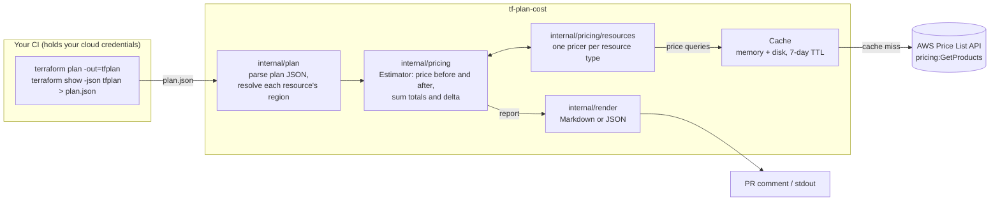

# tf-plan-cost

[](https://github.com/mubarak-j/tf-plan-cost/actions/workflows/ci.yml)

**See what a Terraform change will cost before you merge it.**

`tf-plan-cost` reads a Terraform plan and works out how much the change adds to or removes from your monthly AWS bill, resource by resource. It gets prices from the official [AWS Price List API](https://docs.aws.amazon.com/awsaccountbilling/latest/aboutv2/price-changes.html) instead of a hardcoded table. When it can't price something exactly, it says so instead of guessing.

```
$ tf-plan-cost diff plan.json
```

> ### tf-plan-cost: **+$242.24/mo** (was $323.57 → now $565.81)
>
> | Resource | Action | Before | After | Δ/mo |
> |---|---|---|---|---|
> | `aws_eks_node_group.default` | ~ 3 × m6i.large → 5 × m6i.large | $210.24 | $350.40 | +$140.16 |
> | `aws_instance.api[0]` | ~ m6i.large → m6i.xlarge | $72.48 | $142.56 | +$70.08 |
> | `aws_ebs_volume.data` | ~ gp3 100 GB → gp3 500 GB | $8.00 | $40.00 | +$32.00 |

Use it as a **GitHub Action** that comments on pull requests (and can fail when a change costs too much), or as a **CLI**.

> [!NOTE]
> **Status:** the CLI and GitHub Action work. **GitHub App** mode, which posts a Check Run without AWS credentials in your CI, is in preview: the server is built and tested, but there is no hosted App to install yet.

## Architecture



1. **Parse** (`internal/plan`). Reads `terraform show -json` output: every managed resource change with its `before` and `after` values, and which values are unknown until apply. Each resource's region is taken from, in order:
   - its own `region` attribute (AWS provider v6+);
   - its provider configuration (a literal, or a root `var.*`, including provider aliases and modules);
   - the `--region` flag.
2. **Price** (`internal/pricing`). The estimator prices each side of every change (`before` for deletes, `after` for creates, both for updates and replacements). Unchanged resources are priced too, so the totals reflect the whole stack, not just the diff.
3. **Look up** (`internal/pricing/resources`). Each pricer turns resource attributes into exact Price List queries, for example `instanceType=m6i.large, regionCode=us-east-1, operatingSystem=Linux, tenancy=Shared`. A query must match exactly one on-demand price. Zero or several matches mark the resource as *not priced*, never as a guess.
4. **Render** (`internal/render`). Writes a Markdown comment, with a hidden `<!-- tf-plan-cost -->` marker so later runs can update the same PR comment, or JSON for scripts. Amounts are decimal strings to avoid floating-point rounding.

Cloud credentials for `terraform plan` stay in your own CI. `tf-plan-cost` only needs read access to public AWS prices.

## GitHub Action

Add one step after `terraform plan`. It prices the plan and then creates or updates a single comment on the pull request. It also writes the same report to the job summary.

```yaml
permissions:
  contents: read
  pull-requests: write # create/update the cost comment
  id-token: write      # OIDC for AWS credentials

steps:
  # ... checkout, AWS credentials, terraform init/plan ...
  - run: terraform show -json tfplan > plan.json
  - uses: mubarak-j/tf-plan-cost@main # pin to @v1 once released
    with:
      plan: plan.json
```

A complete workflow is in [`examples/workflows/terraform-cost.yml`](examples/workflows/terraform-cost.yml).

**AWS credentials.** The step needs credentials allowed to call `pricing:GetProducts` (see [Usage](#1-give-it-aws-credentials)). [`examples/aws-oidc-role`](examples/aws-oidc-role) is Terraform for an OIDC role limited to that one action, so no keys are stored in GitHub.

**Cost limit.** To fail the step when a pull request adds more than a set amount per month, add `.tf-plan-cost.yml` to the repository root:

```yaml
fail_above_monthly_usd: 500
```

The comment still posts and shows a caution. Decreases never fail. Unknown keys are rejected, so a typo can't silently turn the limit off.

| Input | Default | Description |
|---|---|---|
| `plan` | *(required)* | Path to `terraform show -json` output |
| `mode` | `action` | `action`, or `app` for [GitHub App mode](#github-app-preview) |
| `app-url` | `https://tf-plan-cost.mubarak-j.com` | App server URL (app mode); change it only for your own server |
| `region` | `$AWS_REGION` | Region for resources whose region isn't in the plan |
| `comment` | `true` | Create or update the PR comment |
| `comment-id` | `default` | Separate comment per Terraform root, e.g. `prod` |
| `comment-on-no-change` | `false` | Comment even when nothing changes (an existing comment is always updated) |
| `config` | `.tf-plan-cost.yml` | Limit config; a missing file means no limit |
| `github-token` | `${{ github.token }}` | Needs `pull-requests: write` (action mode) |

| Output | Example |
|---|---|
| `delta-monthly-usd` | `242.24` |
| `total-before-monthly-usd` / `total-after-monthly-usd` | `323.57` / `565.81` |
| `exceeded` | `false` |
| `comment-url` | link to the comment |
| `check-url` | link to the Check Run (app mode) |

**Behavior:**
- **Monorepos:** run the step once per Terraform root with a different `comment-id`. Each root then gets its own comment.
- **Updating:** a later run finds the comment by a hidden marker and edits it. Only comments written by the same token's user are matched, so a person quoting the marker is never edited.
- **Fork PRs and push events:** commenting is skipped with a warning, because the token is read-only or there is no PR. The report still goes to the job summary.
- **No resource changes:** nothing is posted, unless an earlier comment exists. That comment is updated to "no cost change".

**Notes:**
- Until the first release, the action builds `tf-plan-cost` from source on each run. It uses the runner's Go when one is installed (any Go 1.21+ fetches the right version itself), so your `PATH` is unchanged. It installs Go only when none is present.
- On GitHub Enterprise Server, the API URL is read from `GITHUB_API_URL`.

## GitHub App (preview)

In app mode the Action doesn't price anything itself. It sends the plan to the tf-plan-cost App, which prices it with **its own** AWS credentials and reports back as `tf-plan-cost[bot]`:

- a **Check Run** on the pull request's head commit (`+$242.24/mo`), which fails when the increase is above `fail_above_monthly_usd`, so branch protection can require it;
- the same PR comment as action mode.

Your workflow needs no AWS pricing credentials and no `pull-requests: write`:

```yaml
permissions:
  contents: read
  id-token: write # proves to the App which repository and run the plan comes from

steps:
  # ... checkout, terraform init/plan ...
  - run: terraform show -json tfplan > plan.json
  - uses: mubarak-j/tf-plan-cost@main
    with:
      plan: plan.json
      mode: app
```

**What leaves your CI.** Before uploading, the action runs `tf-plan-cost strip`, which keeps only what pricing needs:
- resource changes, with every value Terraform marks as sensitive replaced by `null`;
- each AWS provider's `region` expression, and only the root variables those expressions use.

Prior state, outputs, other provider arguments (such as access keys) and unrelated variables are dropped. The App prices the plan in memory and never stores or logs it. Run `tf-plan-cost strip plan.json` to see exactly what would be sent.

**How the upload is trusted.** The action sends the workflow's GitHub Actions OIDC token (audience `tf-plan-cost`). The App checks its signature against GitHub's published keys, along with the issuer, audience and expiry. It then takes the repository, pull request and commit **only from the token's claims**, never from the request. The App must be installed on that repository, and its installation token is limited to that one repository.

**Behavior:**
- **Pull requests only.** Push events are rejected. Pull requests from forks get no OIDC token, so they can't use app mode.
- **Outdated runs.** If the PR has newer commits by the time a plan arrives, the check run is still added to the plan's commit, but the comment is left for the newer run.
- **Re-run.** The App keeps no copy of the plan. Clicking *Re-run* on the check, or *Re-run all checks* on its suite, adds a link to the workflow run to re-run instead.
- **Outputs** are the same as action mode, plus `check-url`. The step itself doesn't fail on the limit; the check does.

**App permissions:** Checks (read and write), Pull requests (read and write), Contents (read, for `.tf-plan-cost.yml`), Metadata (read). The App subscribes only to the `check_run` event. GitHub also sends it `check_suite` events, because it has the Checks permission.

### Running the App server

`tf-plan-cost serve` runs the App: `POST /webhook`, `POST /v1/plans` and `GET /healthz`. It's configured with environment variables; see [`.env.example`](.env.example).

| Variable | Description |
|---|---|
| `GITHUB_APP_ID` | App ID |
| `GITHUB_PRIVATE_KEY` | App private key: PEM contents or a path to the `.pem` file |
| `GITHUB_WEBHOOK_SECRET` | Webhook secret, checked against `X-Hub-Signature-256` |
| `PORT` | Listen port (default `8080`) |
| `TF_PLAN_COST_OIDC_AUDIENCE` | Expected token audience (default `tf-plan-cost`) |
| `TF_PLAN_COST_CACHE_DIR` | Price cache directory (default: memory only) |

The server reads prices with the standard AWS credential chain, which needs only `pricing:GetProducts`. Plan uploads are limited to 5 MB.

To host it yourself on AWS Lambda for about $0 a month, follow [`deploy/aws`](deploy/aws/README.md). It covers registering the App, storing its secrets in SSM Parameter Store and deploying with Terraform.

## Install

**From source** (Go 1.27+):

```sh
go install github.com/mubarak-j/tf-plan-cost/cmd/tf-plan-cost@latest
```

Or clone the repository and run `go build ./cmd/tf-plan-cost`.

**Container image:**

```sh
docker build -t tf-plan-cost .
```

The image is distroless (`static-debian12:nonroot`) and contains only the binary and CA certificates.

Prebuilt binaries and a published image are planned for the first release.

## Usage

### 1. Give it AWS credentials

The AWS Price List API requires signed requests, even though prices are public. Any credentials from the standard AWS chain work (environment variables, an SSO profile, OIDC in CI, an instance role), as long as they allow one action:

```json
{
  "Version": "2012-10-17",
  "Statement": [{ "Effect": "Allow", "Action": "pricing:GetProducts", "Resource": "*" }]
}
```

Locally, an SSO profile is the easiest option:

```sh
aws sso login --profile my-profile
export AWS_PROFILE=my-profile
```

### 2. Export your plan as JSON

```sh
terraform plan -out=tfplan
terraform show -json tfplan > plan.json
```

### 3. Run it

```sh
tf-plan-cost diff plan.json                 # Markdown to stdout
tf-plan-cost diff plan.json --format json   # machine-readable report
terraform show -json tfplan | tf-plan-cost diff -   # read from stdin
```

| Flag | Default | Description |
|---|---|---|
| `--region` | `$AWS_REGION` or `$AWS_DEFAULT_REGION` | Region for resources whose region isn't in the plan |
| `--format` | `markdown` | `markdown` or `json` |
| `--no-cache` | `false` | Don't read or write the price cache |
| `--cache-dir` | user cache dir (`~/Library/Caches/tf-plan-cost/prices` on macOS, `~/.cache/tf-plan-cost/prices` on Linux) | Where cached prices are stored |

Other commands (run any with `-h` for its flags):
- `tf-plan-cost github-comment --report report.json` posts a JSON report (from `diff --format json`) as a PR comment. It's what the Action runs in action mode, and it reads the standard `GITHUB_*` environment variables.
- `tf-plan-cost strip plan.json` prints the plan with sensitive values and everything pricing doesn't need removed.
- `tf-plan-cost upload --app-url URL plan.json` sends a stripped plan to the App. It's what the Action runs in app mode.
- `tf-plan-cost serve` runs the App server (see [Running the App server](#running-the-app-server)).

**Exit codes:**
- `0`: success, including when some resources are listed as not priced.
- `1`: a real error, such as an unreadable plan or missing AWS credentials.
- `2`: invalid usage.
- `3`: (`github-comment` only) the cost increase is above `fail_above_monthly_usd`.

### Reading the output

- **Table:** every created, updated, deleted or replaced resource that could be priced, largest change first.
- **Notes:** charges that depend on usage and are left out, with their rate where AWS publishes one. For example: `data processing at $0.045/GB not included`.
- **Not priced:** changed resources that couldn't be priced, and why. A warning banner appears when a *supported* resource couldn't be priced, because its real cost is unknown.
- **Footer:** the assumptions used and the date of the oldest price.

## Supported resources

| Resource | What's priced | What's noted but not priced |
|---|---|---|
| `aws_instance` | Linux on-demand compute (shared or dedicated tenancy), root and inline EBS volumes | Root volume when its size comes from the AMI |
| `aws_ebs_volume` | Storage for gp2, gp3, io1, io2, st1, sc1 and standard; gp3 IOPS and throughput above baseline; io1 IOPS; io2 tiered IOPS | Magnetic I/O requests |
| `aws_db_instance` | Instance and storage for PostgreSQL, MySQL and MariaDB, Single-AZ or Multi-AZ; io1/io2 IOPS; gp3 IOPS above baseline | gp3 throughput above baseline |
| `aws_nat_gateway` | Hourly charge (public or private) | Data processing per GB |
| `aws_lb` / `aws_alb` | Hourly charge for application, network and gateway load balancers | Capacity units (LCU/NLCU/GLCU) |
| `aws_eks_cluster` | Control plane (standard support) | Extended support rate, Auto Mode per-node fees |
| `aws_eks_node_group` | `desired_size` × on-demand price of the first instance type | Node root volumes; other instance types in the list |

All other resource types are listed under **Not priced** as "resource type not supported yet". Many of them, such as IAM, security groups and S3 bucket settings, cost nothing on their own.

## Known limitations

**Pricing assumptions**
- Prices are **on-demand list prices**: no Savings Plans, Reserved Instances, EDP or other discounts, credits or Free Tier. Your actual bill may be lower.
- **Linux** only. The plan doesn't say which OS an AMI runs, so Windows or RHEL instances are priced as Linux. Windows EKS node groups are marked not priced.
- **730 hours a month**, and every resource is assumed to run all month. Auto Scaling, schedules and partial months are not modeled.
- **Usage-based charges are excluded**: data transfer, NAT data processing, load balancer capacity units, requests, snapshots and backups. For network-heavy workloads these can exceed the fixed costs shown.
- Prices are cached for **7 days**. Use `--no-cache` to force fresh prices.

**Not priced (listed with a reason, never guessed)**
- Spot instances and spot node groups.
- Dedicated hosts.
- Instances and node groups whose instance type comes from a launch template.
- RDS engines other than PostgreSQL, MySQL and MariaDB (Oracle, SQL Server, Aurora).
- Regional NAT gateways.
- Values that are only known after apply. For example, `instance_type = some_resource.attr` or a volume size taken from a snapshot.

**Interpreting unset attributes**
- When you leave an optional attribute unset, Terraform shows it as "known after apply" because the provider fills in a default.
- For attributes that only qualify a price, `tf-plan-cost` assumes the AWS default: on-demand rather than spot, shared tenancy, zonal NAT gateway, gp3 baseline IOPS and throughput, Single-AZ, and extended EKS support.
- Attributes that determine the price itself (instance type, size, io1/io2 IOPS) must be known, or the resource is marked not priced.

**Scope**
- AWS only, and only the resource types listed above.
- Regions must be known statically or passed with `--region`. A provider region set from an environment variable in CI, a local value or a module variable can't be read from the plan. AWS provider v6 avoids this, because it records each resource's region in the plan.
- The plan JSON contains your resource attributes, which can include sensitive values. In CLI and action mode, `tf-plan-cost` only sends price queries (service, region and product attributes) to AWS, never the plan itself. In app mode, only the stripped plan is sent to the App (see [What leaves your CI](#github-app-preview)).

## Development

```sh
go test -race ./...                       # unit and golden tests (no AWS access needed)
go test ./cmd/tf-plan-cost -update        # regenerate golden output after an intended change
AWS_PROFILE=... go test -tags integration ./cmd/tf-plan-cost -run TestRecordPrices   # re-record live prices
go run github.com/golangci/golangci-lint/v2/cmd/golangci-lint@v2.14.0 run ./...
```

- **Fixtures:** test plans live in `testdata/plans/`. `create.json` is real Terraform output, generated from `testdata/terraform/create`.
- **Recorded prices:** `testdata/prices.json` holds prices recorded from the live API, so tests run offline and stay deterministic.

## License

[Apache 2.0](LICENSE)
